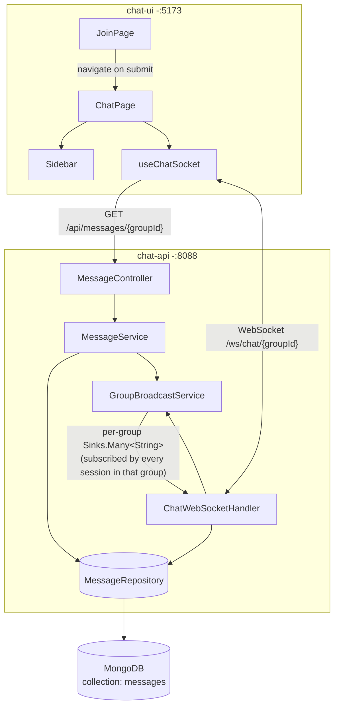
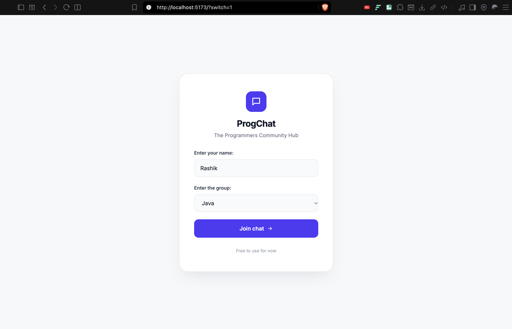
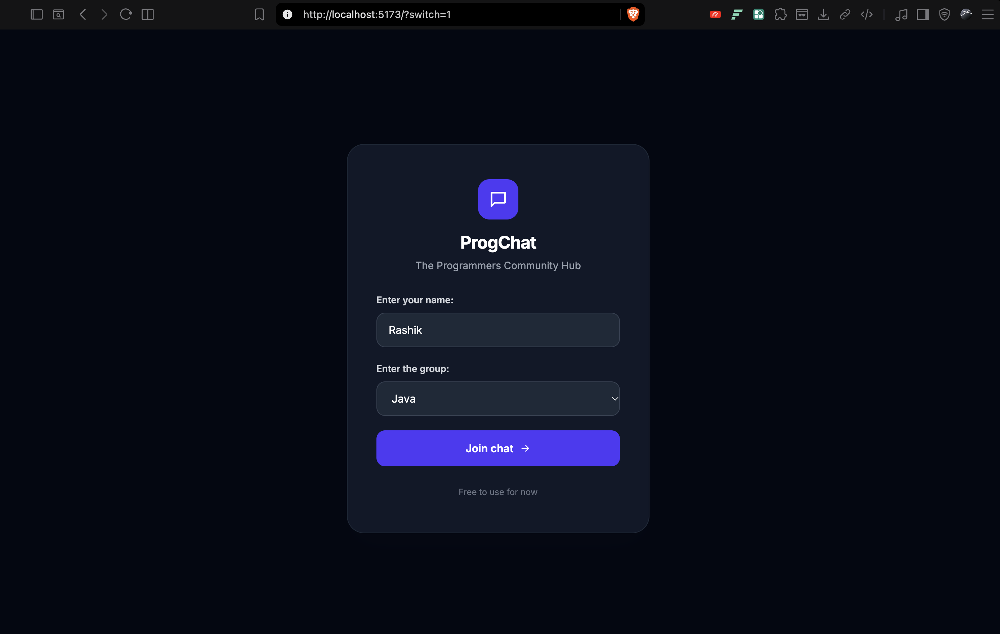
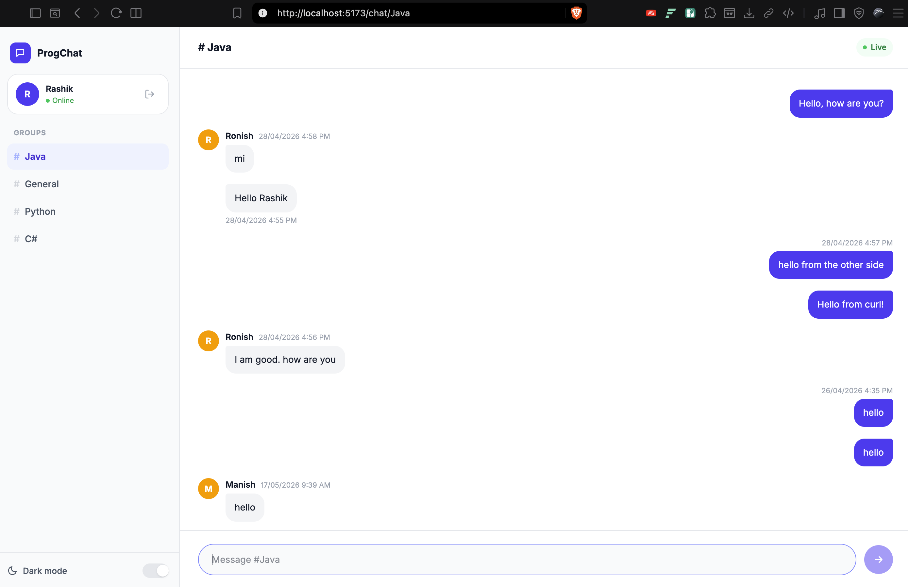
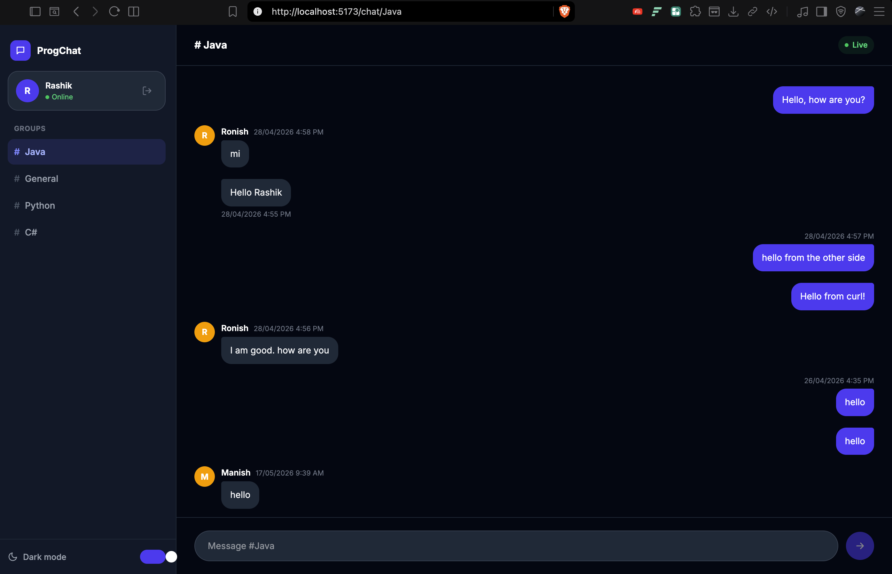

# ProgChat

Real-time group chat for people who want to talk shop in their programming
language of choice - join the `Java`, `Python`, `C#`, or `General` room (or
any room you type into the URL) and chat live with everyone else in it.

## Overview

ProgChat is a two-part application: a reactive Spring Boot backend that
persists messages to MongoDB and fans them out over WebSocket, and a React
single-page frontend that lets you pick a name, join a language community,
and chat in real time. It has no accounts -just pick a display name and
jump into a room. Built as a learning/portfolio project exploring Spring
WebFlux, Reactor, and a from-scratch WebSocket chat protocol end to end.

## Features

- **Real-time messaging** over WebSocket -messages sent by anyone in a group
  are broadcast to every other connected member of that group instantly.
- **Language-based community rooms** -join `Java`, `Python`, `C#`, `General`,
  or any custom group by URL.
- **Typing indicators** -see when someone else in your room is typing,
  without those pings ever being saved as messages.
- **Persistent history** -messages are stored in MongoDB and reloaded when
  you (re)join a room.
- **Both REST and WebSocket write paths broadcast live** -a message saved
  via the REST API reaches connected WebSocket clients just like a
  WebSocket-sent one does.
- **Switchable identity** -change your display name at any time via the
  sidebar's log-out control, without losing your place.
- **Light/dark theme**, persisted per browser and defaulting to your OS
  preference.
- **Client-side routing** -each room has its own shareable URL
  (`/chat/:groupId`), with the browser back/forward buttons working as
  expected.

## Technology Stack

| Layer | Technology |
|---|---|
| Backend | Java 21, Spring Boot 4 (WebFlux), Project Reactor, Jackson 3 |
| Database | MongoDB (Reactive Spring Data MongoDB driver) |
| Frontend | React 19, Vite 8, React Router 7, Axios |
| Styling | Tailwind CSS 4 (class-based dark mode), Inter (Google Fonts) |
| Local infra | Docker Compose (MongoDB 7, for local development) |

## System Architecture



**Message flow:**
1. A client opens `ws://.../ws/chat/{groupId}`. `ChatWebSocketHandler` reads
   `groupId` from the URL and subscribes the session to that group's shared
   broadcast sink (owned by `GroupBroadcastService`, created on first use,
   never torn down even if the group briefly has zero members).
2. An inbound frame is either a **typing ping** (`{"type":"typing",...}`,
   broadcast immediately, never persisted) or a **real message** (saved to
   MongoDB first, then the saved document -now with its generated `id` and
   `timestamp` -is broadcast to every session subscribed to that group).
3. A message sent via the **REST** `POST /api/messages` endpoint goes through
   the same `GroupBroadcastService`, so it reaches live WebSocket clients
   exactly like a WebSocket-submitted message does.

## Project Structure

```
chat-application/
├── docker-compose.yml              # local MongoDB for development
├── chat-api/                       # Spring WebFlux backend
│   ├── pom.xml
│   └── src/main/java/app/rashiktimalsina/chat_api/
│       ├── ChatApiApplication.java         # entry point
│       ├── config/WebSocketConfig.java     # CORS policy + WS route mapping
│       ├── controller/MessageController.java
│       ├── document/Message.java           # Mongo entity / API model
│       ├── handler/ChatWebSocketHandler.java
│       ├── repository/MessageRepository.java
│       └── service/
│           ├── MessageService.java
│           └── GroupBroadcastService.java  # shared per-group broadcast sinks
└── chat-ui/                        # React frontend
    └── src/
        ├── main.jsx                # entry -router + theme provider
        ├── App.jsx                 # route table
        ├── pages/
        │   ├── JoinPage.jsx        # name/group entry + identity switching
        │   └── ChatPage.jsx        # main chat screen
        ├── components/Sidebar.jsx  # group nav, identity, dark-mode toggle
        ├── hooks/
        │   ├── useChatSocket.js    # REST history + WebSocket lifecycle
        │   └── useTheme.js
        ├── context/                # dark/light theme state
        └── lib/                    # localStorage helpers, time formatting
```

## Prerequisites

- JDK 21
- Node.js 20+ and npm
- A MongoDB instance -either a MongoDB Atlas cluster, or a local one via
  Docker

## Installation & Setup

```bash
git clone <this-repo-url>
cd chat-application

# Backend config
cd chat-api
cp src/main/resources/application-example.yaml src/main/resources/application.yaml
# edit application.yaml with your MongoDB URI, or export env vars instead (see below)
cd ..

# Frontend config
cd chat-ui
cp .env.example .env
npm install
cd ..
```

## Environment Variables

**Backend** (`chat-api/src/main/resources/application.yaml`, gitignored -
or export these as environment variables instead):

| Variable | Default | Description |
|---|---|---|
| `MONGODB_URI` | `mongodb://localhost:27017/chatdb` | MongoDB connection string |
| `SERVER_PORT` | `8088` | Port the API listens on |
| `CORS_ALLOWED_ORIGINS` | `http://localhost:5173` | Comma-separated list of origins allowed to call the API with credentials |

**Frontend** (`chat-ui/.env`, gitignored -copied from `.env.example`):

| Variable | Default | Description |
|---|---|---|
| `VITE_API_BASE_URL` | `http://localhost:8088/api` | REST API base URL |
| `VITE_WS_BASE_URL` | `ws://localhost:8088/ws/chat` | WebSocket base URL |

## Running the Application

**1. Database** -pick one:

```bash
# Option A: local MongoDB via Docker
docker compose up -d mongo
# then set MONGODB_URI=mongodb://localhost:27017/chatdb

# Option B: use your MongoDB Atlas connection string directly
```

**2. Backend**

```bash
cd chat-api
./mvnw spring-boot:run
```

The API listens on `http://localhost:8088`.

**3. Frontend**

```bash
cd chat-ui
npm run dev
```

Open `http://localhost:5173` - you will land on the join screen.

## API Documentation

### REST -`/api/messages`

| Method | Path | Description |
|---|---|---|
| `GET` | `/api/messages/{groupId}` | Message history for one group |
| `GET` | `/api/messages` | All messages across every group |
| `POST` | `/api/messages` | Save a message and broadcast it to connected WebSocket clients in that group |

### WebSocket -`/ws/chat/{groupId}`

**Client → server**, a chat message:
```json
{ "sender": "Rashik", "content": "Hello" }
```

**Client → server**, a typing ping (never persisted):
```json
{ "type": "typing", "sender": "Rashik", "groupId": "Java" }
```

**Server → every client in the group**, a saved message:
```json
{
  "id": "6720f1c2a9e4b51d2c3f9a10",
  "sender": "Rashik",
  "groupId": "Java",
  "content": "Hello",
  "timestamp": "2026-11-03T06:05:00Z"
}
```

### `Message` (MongoDB collection `messages`)

| Field | Type | Set by |
|---|---|---|
| `id` | string | MongoDB |
| `sender` | string | client |
| `groupId` | string | server, from the WebSocket URL path (or request body on REST POST) |
| `content` | string | client |
| `timestamp` | ISO-8601 instant | `@CreatedDate` |

## Screenshots

| | Light | Dark |
|---|---|---|
| **Join screen** |  |  |
| **Chat room** |  |  |

## Testing

```bash
# Backend -currently a single Spring context-load smoke test
cd chat-api && ./mvnw test

# Frontend -lint only; no test runner is configured yet
cd chat-ui && npm run lint
```


## Author

**Rashik Timalsina** -[@RashikTimalsina](https://github.com/RashikTimalsina)
